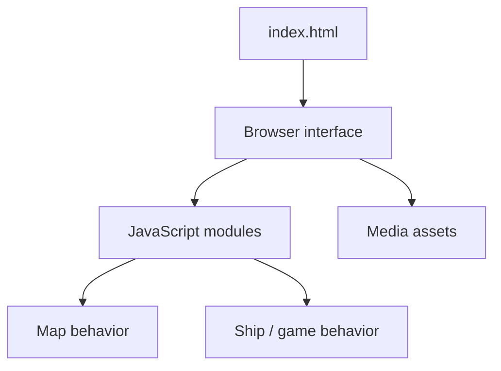

<div align="center">

# Barcos.g — Naval Battle Map Prototype

**A browser-based experiment in interactive mapping and naval-game presentation.**


</div>

## Contents

- [Overview](#overview)
- [Project goals](#project-goals)
- [Application structure](#application-structure)
- [Run locally](#run-locally)
- [Technology](#technology)
- [Development notes](#development-notes)
- [License](#license)

## Overview

Barcos.g is a browser prototype for a naval-battle concept built around a world map. The project combines an HTML entry point, JavaScript modules, and map-related media to explore an interactive geographic interface.

The repository should be considered a prototype: this README does not imply a complete naval strategy game, multiplayer backend, or finished combat system.

## Project goals

- Explore a world-map-first game interface
- Render map assets in a browser
- Organize map and vessel behavior in JavaScript
- Prototype the presentation of a naval strategy experience

## Application structure



This is a conceptual view based on the repository's entry point and asset folders; it is not a formal architecture specification.

## Run locally

The repository does not include a documented package manager or build pipeline. To serve the static files locally:

```bash
git clone https://github.com/Edumarek123/Barcos_g.git
cd Barcos_g
python3 -m http.server 8000
```

Open [http://localhost:8000](http://localhost:8000) in your browser.

If the project depends on browser APIs that restrict direct file access, serving it over HTTP avoids common local-file restrictions.

## Technology

- HTML
- CSS
- JavaScript
- Browser-based rendering
- SVG and other map/media assets

## Development notes

The repository currently provides a prototype structure rather than a formal API. Before extending it, identify the active script entry points and map asset paths in `index.html`.

## License

No `LICENSE` file is currently included. Unless a license is added, reuse and redistribution permissions are not granted by this repository.
